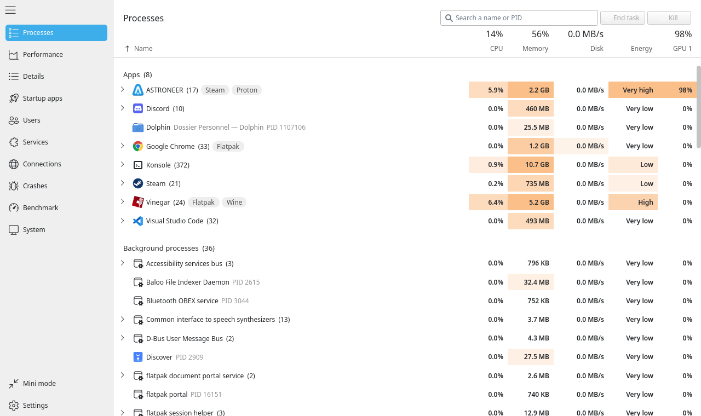
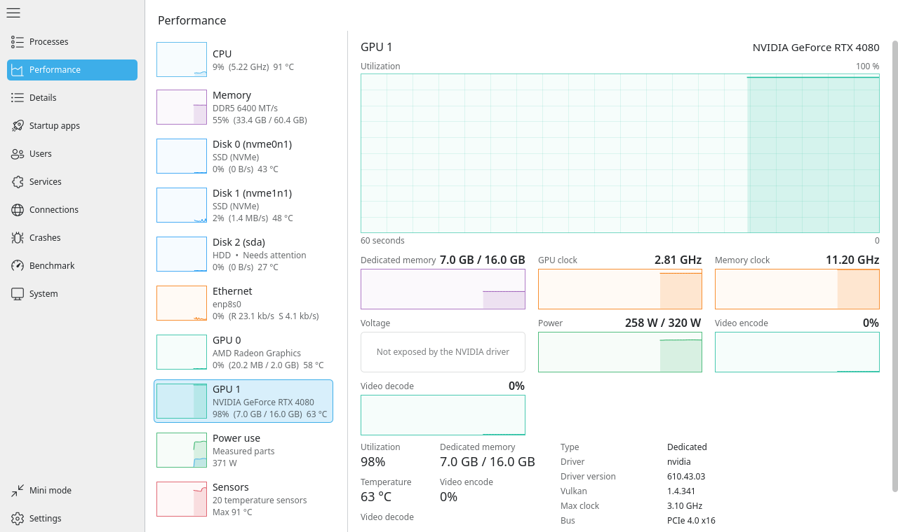

# taskmgr-rust

[](LICENSE)

A task manager for Linux that names what is really running: a Proton game
shows up as the game, not as `wine64-preloader` and `pressure-vessel`.



- **Processes grouped by application**, through Flatpak, Wine and Proton,
  Steam, AppImage, Snap and NixOS wrappers.
- **Every device on its own**: one graph per disk, GPU, network adapter,
  fan and sensor.
- **Details, services, startup apps, users, connections, crashes,
  benchmarks** and a hardware tree with live readings.
- Native look on KDE Plasma, works on GNOME and other desktops, English
  and French.



## Install

> [!WARNING]
> taskmgr-rust is very young and has been tested on a handful of systems
> only. If something is missing, wrong or crashes on yours, please
> [open an issue](https://github.com/RsMan-Dev/taskmgr-rust/issues) with
> your distribution, desktop and what you saw.

Download `taskmgr-x86_64.AppImage` from the
[releases](https://github.com/RsMan-Dev/taskmgr-rust/releases), then:

```sh
chmod +x taskmgr-x86_64.AppImage
./taskmgr-x86_64.AppImage
```

On NixOS, use `nix run github:RsMan-Dev/taskmgr-rust` rather than
`appimage-run`: its sandbox hides part of what other processes are and
blocks administrator actions.

From source, with Rust 1.88+, Qt 6.5+ and Kirigami 6:
`cargo build --release`.

## Permissions

Runs as a normal user, never as root. Per-process network use and CPU
power ask for the administrator password through polkit when you turn
them on. To read CPU power without it, a udev rule can open the RAPL
counter to a group:

```
SUBSYSTEM=="powercap", KERNEL=="intel-rapl:*", RUN+="/bin/chgrp wheel /sys%p/energy_uj", RUN+="/bin/chmod g+r /sys%p/energy_uj"
```

The kernel restricts it since CVE-2020-8694: only do this on a
single-user machine.

## Development

```sh
nix develop
cargo test --workspace
cargo run -p taskmgr
```

`crates/taskmgr-core` reads `/proc`, `/sys`, cgroups and D-Bus, without
Qt or root. `crates/taskmgr` is the Qt Quick interface, bridged with
[cxx-qt](https://github.com/KDAB/cxx-qt).

## License

MIT. Icons: [Fluent UI System Icons](https://github.com/microsoft/fluentui-system-icons) (MIT).
